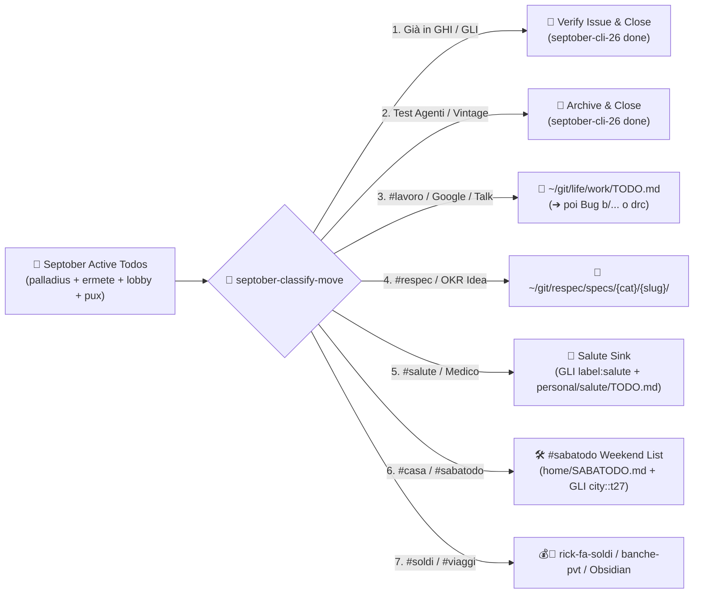

# 🧹 Septober Classify & Move (`septober-classify-move`) 🚛➡️🏠💼

This skill implements Riccardo's daily **"Travaso" (GTD Inbox Zero)** workflow for **Septober**.

Septober is used as a **high-speed capture inbox** (via voice notes to Ermete/Lobby on Telegram, quick web entry, or `septober-cli-26`). To prevent Septober from accumulating 100+ stale items, this skill runs daily (or on-demand) to **classify, move ("travasare"), and mark as `done`** items once they are safely hosted in their permanent repository or tracker.

---

## 🎯 Core Philosophy: "Drain First, Then Mark Done"

1. **Septober is a Buffer, Not a Graveyard**: Long-running projects, work deliverables, code bugs, and specs do **not** live forever in Septober. They get captured in Septober and drained into their proper system of record.
2. **Atomic Travaso**: Never mark a Septober todo as `done` until its content (title, description, URL, context, and `[Septober #<ID>]` provenance badge) has been written to and verified in its destination sink.
3. **What Stays in Septober?**: Only **< 10 immediate physical/weekend tasks** (like `#sabatodo` chores at home that need no external bug tracker) stay active in Septober.

---

## 🗺️ The 7 Destination Sinks (Taxonomy & Routing Rules)



### 1. 💼 Lavoro Sink (`WORK_TODO` ➔ `~/git/life/work/TODO.md`)
- **Triggers**: `project.name == "work"`, or tags/keywords `#lavoro`, `#google`, `#slides`, `#devfest`, `#sreday`, `#concur`, `#gcard`, `#workshop`, `#brag`, `#l7`, `#GRAD`.
- **Action**:
  1. Append the task to **`~/git/life/work/TODO.md`** with full context, due date, tags, `[Septober #<ID>]`, and a suggested **"Target Hosting"** action.
  2. Mark as `done` on Septober (`septober-cli-26 done <ID>`).
- **Downstream Agent Rule (in `~/git/life/GEMINI.md`)**:
  - Whenever an agent opens `~/git/life`, if `work/TODO.md` is **not empty**, it must drain those items ASAP — not by completing a 3-day task on the spot, but by **creating/linking a permanent hosting container** (an open Buganizer/TaskFlow `b/...` bug, a `work/bugs/YYYYMMDD-b<id>-<slug>/` folder, a GitHub Issue, or an entry in `TOM.md`) and removing the line from `work/TODO.md`.

### 2. 🏥 Gruppo SALUTE (`SALUTE` ➔ `~/git/ricc-personal-life/personal/salute/TODO.md` + GLI)
- **Triggers**: Tags/keywords `#salute`, `#medico`, `#podologa`, `#dentista`, `#analisi`, `#ospedale`, `#farmacia`, `#dottore`.
- **Action**:
  1. Append to **`~/git/ricc-personal-life/personal/salute/TODO.md`**.
  2. If it requires booking an appointment or physical visit in a city (e.g. Zurich), also create a GitLab Issue in `palladius/ricc-personal-life` with dual labels `type:city`, `city::zurigo` (or `t27`), and `salute`.
  3. Mark as `done` on Septober.

### 3. 🏠 Gruppo CASA & 🛠️ `#sabatodo` (`CASA_SABATODO` ➔ `~/git/ricc-personal-life/home/SABATODO.md`)
- **Concept**: Revival of Riccardo's classic **`#sabatodo`** hashtag — things to do at home on Saturday / over the weekend!
- **Triggers**: Tags/keywords `#sabatodo`, `#casa`, `#bici`, `#colnago`, `#homelab`, `#jellyfin`, `#raspberrypi`, `#t27`, `#cantina`, `#studio`, `#router`, `#wireguard`.
- **Two-Tier Handling**:
  - **Tier A — Quick Physical Weekend Chores (`#sabatodo`)**: Tasks like *"Cercare la mini pompa della bicicletta"* or *"Riordinare cavi Studio Giallo"*.
    - Sync to **`~/git/ricc-personal-life/home/SABATODO.md`** (grouped by room/zone: *Studio Giallo, Cantina/Bici, Salotto/TV, Homelab*).
    - Optional: Keep up to **5 active `#sabatodo` items** in Septober if Riccardo wants them on his phone for Saturday morning, OR drain them to `home/SABATODO.md` and mark `done` on Septober.
  - **Tier B — Multi-step Home / Host Projects**: Tasks like *"Installare Jellyfin"* or *"Verificare WireGuard su Zyxel T27"*.
    - Create a GitLab Issue (GLI) on `palladius/ricc-personal-life` via `bin/create_city_todo.rb -l t27` or `bin/create_hostname_todos.rb -H <host>` with label `sabatodo` / `casa`, then mark `done` on Septober.

### 4. 📐 Gruppo RESPEC & Code (`RESPEC` / `CODE_GHI`)
- **Triggers**:
  - URL or description mentions `git/respec` or tags `#respec`, `#okr`, `#spec`.
  - Specific repository feature/bug (e.g. `carchess3d`, `family-mahjong-3d`, `smurfs-and-dragons`, `rails8-app-on-gcp`).
- **Action**:
  - If an issue URL (`github.com/.../issues/N` or `gitlab.com/.../work_items/N`) is **already present** in `url` or `description`: verify it exists and immediately mark `done` on Septober!
  - Otherwise, create the spec under `~/git/respec/specs/{apps,tools,games,agents,meta}/<slug>/SPEC.md` (or open a GitHub Issue via `gh issue create`) and mark `done` on Septober.

### 5. 💰 Gruppo SOLDI & Finanze (`SOLDI_FINANZE`)
- **Triggers**: `project.name == "soldi"`, or tags `#soldi`, `#banche`, `#iban`, `#tasse`, `#business`, `#startup`.
- **Action**:
  - Side-business / monetization ideas (`rick-fa-soldi`) ➔ Append to `~/git/rick-fa-soldi/TODO.md` (or GHI on `palladius/rick-fa-soldi`).
  - Banking / tax / IBAN workflows (`banche-pvt`) ➔ Append to `~/git/ricc-personal-life/personal/finanze/TODO.md` (or `~/git/banche-pvt/TODO.md`).
  - Mark `done` on Septober.

### 6. 💎 Gruppo OBSIDIAN / Viaggi / Eventi (`OBSIDIAN_EVENT`)
- **Triggers**: Tags `#viaggio`, `#viaggi`, `#sardegna`, `#compleanno`, `#50anni`, `#modena`, `#brasile`, or past trip dates.
- **Action**:
  - Patch the relevant note in Obsidian (`~/Documents/PBTPersonalSync/` or `~/obsidian-pbt/`) or `~/git/ricc-personal-life/family/` (e.g. 50th Birthday guest list, past trip receipts/screenshots) and mark `done` on Septober.

### 7. 🧪 Test Agenti & Archeologia Vintage (`TEST_OR_VINTAGE`)
- **Triggers**:
  - Agent identity/heartbeat tests (`auto-identity verification`, `Test firma`, `Controllo chele e acquario`, `#test`).
  - Ancient todos (`created_at < 2025-01-01`).
- **Action**:
  - Preserve any historical link (like the 2022 Septober Genesis Google Doc) in `~/git/septober/README.md`, then mark `done` on Septober.

---

## 🚀 Usage & Commands

Use the companion script `bin/septober-classify-move` in `~/git/septober`:

```bash
# 1. Dry-Run: Fetch all active todos from Septober and print the Classification Table
python3 ~/git/septober/bin/septober-classify-move --dry-run

# 2. Drain Work Todos into ~/git/life/work/TODO.md + close them on Septober
python3 ~/git/septober/bin/septober-classify-move --drain-work --apply

# 3. Drain Personal (Salute & Casa/#sabatodo) into ~/git/ricc-personal-life/ + close on Septober
python3 ~/git/septober/bin/septober-classify-move --drain-personal --apply

# 4. Close safe items (Already in GHI/GLI + Agent Tests + Vintage 2020-2022 + Past Trips)
python3 ~/git/septober/bin/septober-classify-move --close-safe --apply

# 5. Full Daily Travaso (Drains everything to its sink and leaves Septober LEAN!)
python3 ~/git/septober/bin/septober-classify-move --drain-all --apply
```
